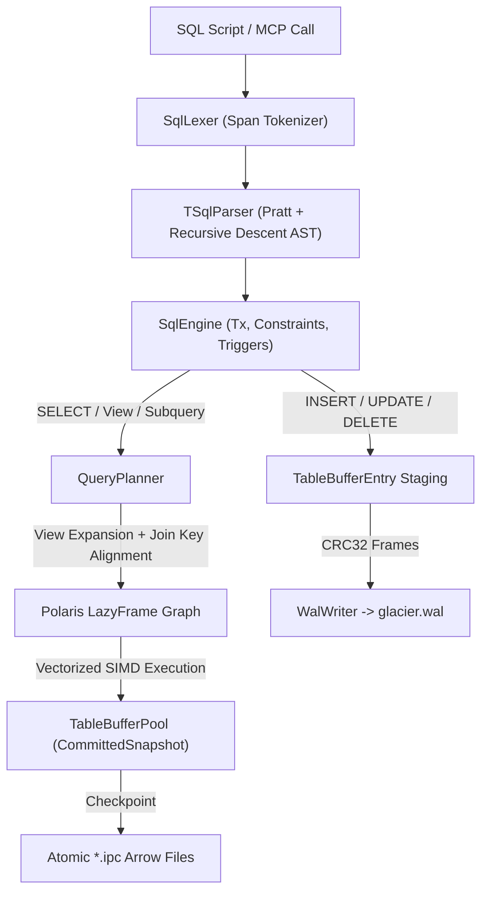

# Glacier.Sql Architecture

`Glacier.Sql` is an embedded relational query layer compiled onto `Glacier.Polaris`. Instead of building a row-by-row volcano iterator engine, SQL queries are compiled into Polaris `LazyFrame` graphs backed by an in-memory buffer pool and CRC32 Write-Ahead Log.

---

## End-to-End Execution Pipeline

---

## Key Subsystems

### 1. Lexer & Pratt Parser (`SqlLexer`, `TSqlParser`, `SqlAst`)

- `SqlLexer` tokenizes T-SQL identifiers, bracketed/quoted strings, numeric literals, comments, and operators.
- `TSqlParser` uses recursive descent for statements (`CREATE`/`ALTER`/`DROP`, `INSERT`/`UPDATE`/`DELETE`, `SELECT`, `BEGIN`/`COMMIT`/`ROLLBACK`, `VIEW`, `TRIGGER`) paired with precedence-climbing Pratt parsing for arithmetic, boolean, comparison, `IN`, and `EXISTS` expressions.

### 2. Vectorized `QueryPlanner` Compilation

`QueryPlanner` translates a `SelectStatement` AST directly into Polaris `LazyFrame` operations:

- Views stored in `CatalogManager` expand recursively as sub-plans.
- Join conditions with mismatched key names rename right-hand keys automatically before `LazyFrame.Join`.
- Scalar subqueries evaluate first into literal constants (`Expr.Lit`), while correlated `EXISTS` / `NOT EXISTS` subqueries lower into semi-/anti-join reductions preserving 3-valued `NULL` logic.
- Aggregations (`COUNT`, `SUM`, `AVG`, `MIN`, `MAX`), `GROUP BY`, `HAVING`, `ORDER BY`, and `TOP n` map straight to Polaris columnar operators.

### 3. Buffer Pool & Storage (`TableBufferPool`, `TableBufferEntry`, `TableStorage`)

- **Buffer caching:** `TableBufferPool` loads Apache Arrow `.ipc` backing files on demand into memory-resident `TableBufferEntry` handles keyed case-insensitively by table name and tracked by `Guid TableId`.
- **Staging vs. committed state:** Active writes accumulate in transactional staging buffers (`CommittedSnapshot` remains isolated for concurrent readers until `COMMIT`).
- **Constraint & trigger enforcement:** `SqlEngine` checks `NOT NULL`, `UNIQUE`, `PRIMARY KEY`, and `CHECK` constraints before committing mutations and builds virtual `inserted`/`deleted` DataFrames when dispatching `AFTER` or `INSTEAD OF` trigger chains.

### 4. Write-Ahead Log & Crash Recovery (`glacier.wal`)

- `WalWriter` appends binary `WalRecord` frames (`TxBegin`, `RowInsert`, `RowUpdateDelta`, `RowDeleteDelta`, `TxCommit`, `TxAbort`, etc.) protected by IEEE 802.3 CRC32 checksums (`Crc32.cs`) inside a 32-byte validated header file.
- `CatalogManager.Load()` fails closed with `InvalidDataException` on corrupt WAL headers, halts cleanly on torn EOF frames during `WalReader` scans, and replays only committed mutations matching active `TableId`s past the checkpoint LSN.
- `CatalogManager.Checkpoint()` atomically writes dirty `CommittedSnapshot` tables via temporary `.ipc` swaps and truncates `glacier.wal` back to its 32-byte header when no transactions remain active.

### 5. Async-Fair Concurrency (`AsyncReaderWriterLock`)

Standard .NET `ReaderWriterLockSlim` enforces thread affinity and throws across `await` continuation boundaries. `Glacier.Sql` uses a queue-based `AsyncReaderWriterLock` (`TaskCompletionSource<bool>` + owned `LockReleaser` tokens + `UpgradeReadToWriteAsync`) so read/write locks safely span async query execution and multi-statement transactions. Canonical lock ordering across multi-table operations prevents deadlocks.
